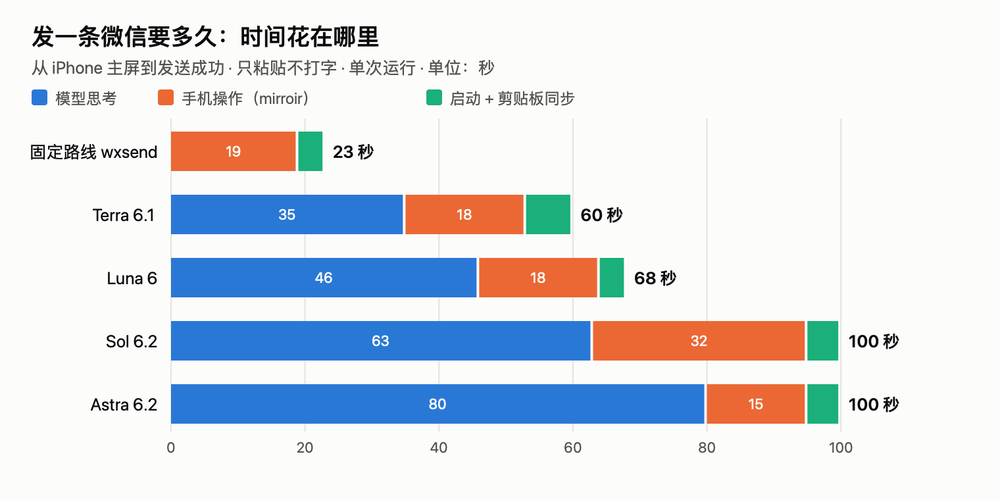

# codex-iphone-wechat

**让 Codex 通过 macOS 的 iPhone 镜像（iPhone Mirroring）在你的 iPhone 上发微信：固定路线 23 秒发一条，不用模型，手机上一个字都不打。**

建立在 [mirroir-mcp](https://github.com/jfarcand/mirroir-mcp) 之上。mirroir 负责看屏幕和点手机；这个仓库补上让 Codex 真正能用、而且用得快的那几块。



## 给 Codex 打的补丁

直接把 mirroir 接上 Codex，我们一共跑了 5 轮，前 4 轮都失败了，第 5 轮里也有一个模型没跑通。下面每一条，都对应一个实际碰到的坑。

| # | 问题 | 补丁 | 效果 |
|---|---|---|---|
| 1 | **iOS 会自动改写打出来的字**：`mirroir` 变成 `Mirroir`，回车被拿去确认候选词，消息停在输入框里没发出去。Luna 为此连按 22 次方向键，最后失败。 | **只粘贴，不打字。** [`outbox`](outbox) 先在 Mac 上把要发的话记进 `chat-log/outbox.md`、放进剪贴板，等 1.5 秒让「通用剪贴板」同步到手机。手机上只用 ⌘V 粘贴。`type_text` 在 mirroir 里直接禁用。 | Terra：25 次调用 / 102 秒 → **13 次 / 60 秒**；四个模型全部成功，文字一字不差 |
| 2 | **模型绝大部分时间在"想"**：每一步都要「读屏 → 推理 → 一个动作」走一遍，单次运行的输入有 27–56 万 token。 | **固定路线回放 [`wxsend`](wxsend)**：打开微信 → 搜联系人 → 粘贴 → 核对 → 发送，全部是 mirroir 的确定性回放（`routes/*.yaml`），分支判断交给 shell。 | **23 秒，0 token**，比最快的模型快 2.6 倍 |
| 3 | **mirroir 默认只开放读屏工具**：模型连打开 app 的工具都看不到，只能空转。 | 在项目里放 [`permissions.json`](bench/.mirroir-mcp/permissions.json)，只放开需要的几个工具，并屏蔽支付类 app。 | 模型能操作了，但能做的事被限制在白名单里 |
| 4 | **`codex exec` 拒绝 mirroir 的操作**：mirroir 把这些工具标成需要审批，非交互模式下又没有人能批，于是直接拒绝。 | `-c approval_policy="never"` 加上 `-c mcp_servers.mirroir.default_tools_approval_mode="approve"`：能做什么由 permissions.json 决定，不再逐次弹出确认。 | 工具调用不再被拒 |
| 5 | **mirroir 自带的 skill 要求发送前先问用户**，`codex exec` 里没人能回答，Astra 问完就停了。 | 在任务说明里写明「这一条消息已经批准发送；标题或文字不对就不发」。 | Astra 从「停下来问」变成 100 秒发送成功 |
| 6 | **别的 MCP 服务白白消耗 token**：模型会先去调记忆、Trace Canvas 之类的工具。 | 测试时用 `-c mcp_servers.<名字>.enabled=false` 关掉无关的服务。 | 少了无效调用 |
| 7 | **悬浮窗口挡住点击**：刘海类 app 的透明窗口盖在镜像窗口上，mirroir 为了不误点，拒绝所有点击。 | 把 iPhone 镜像窗口挪到不被遮挡的位置（参见下文「局限」）。 | 点击恢复正常 |

各模型的完整数据见 [docs/results.md](docs/results.md)，其中包括时间拆分、调用次数和 token 用量。

## 安装（作为 Codex skill）

前提：macOS 15 及以上、iOS 18 及以上，iPhone 镜像能正常连上，手机上已经装了微信。

```bash
# 1. 装 skill
git clone https://github.com/CallSymmetryEcho/codex-iphone-wechat ~/.codex/skills/codex-iphone-wechat

# 2. 给 Codex 接上 mirroir（这个版本已经测过）
codex mcp add mirroir -- npx -y mirroir-mcp@0.50.3

# 3. 自检：会提示你给终端开「辅助功能」和「屏幕录制」权限，按提示开好后重启终端
npx -y mirroir-mcp@0.50.3 doctor
```

可选：`brew install jfarcand/tap/mirroir-mcp`。装了以后 `wxsend` 会直接调用它，每一步能省掉一次 `npx` 启动的时间。

## 使用

直接对 Codex 说「给 张三 发微信：今晚七点见」，它会按 [SKILL.md](SKILL.md) 的说明去调用 `wxsend`。也可以自己在终端里运行：

```bash
~/.codex/skills/codex-iphone-wechat/wxsend "File Transfer" "测试一下"
```

- 联系人写**微信里显示的名字**。第一次用建议先发给「File Transfer」（文件传输助手）试一下。
- 任何一步核对不通过（不在聊天列表、搜不到联系人、对话标题不对、粘贴的文字没出现），脚本都会停下，**不会发送**，并打印原因。
- 每条发出去的消息都会记在本机的 `chat-log/outbox.md` 里，每一步回放的过程记在 `chat-log/route.log` 里。

## 局限

- **坐标是按 iPhone 镜像窗口 355×782 标定的**：比如 Dock 里第三个图标是微信，在 (214, 716)；第一条搜索结果在 (100, 190)。如果手机型号或 Dock 排列不同，要改 `routes/*.yaml` 里的坐标。
- **只有表情符号的联系人名，文字识别读不出来**，`wxsend` 没法核对标题。这种情况下，让模型通过 mirroir 截图来核对。
- 粘贴依赖「通用剪贴板」（Handoff、蓝牙和 Wi‑Fi 都打开，并登录同一个 Apple 账号）。另外，每发一条都会覆盖 Mac 剪贴板里原来的内容。
- 自动操作微信可能违反微信的使用条款，请控制频率，只用在自己的账号上。

## 复现模型对比

```bash
cd ~/.codex/skills/codex-iphone-wechat
BENCH_DISABLE_MCP="trace-canvas theatrum" bench/bench.sh gpt-6.1-terra gpt-6-luna gpt-6.2-sol gpt-6.2-astra
```

结果写在 `bench/results/` 里。图由 `python3 docs/make_chart.py` 生成。

## License

MIT
