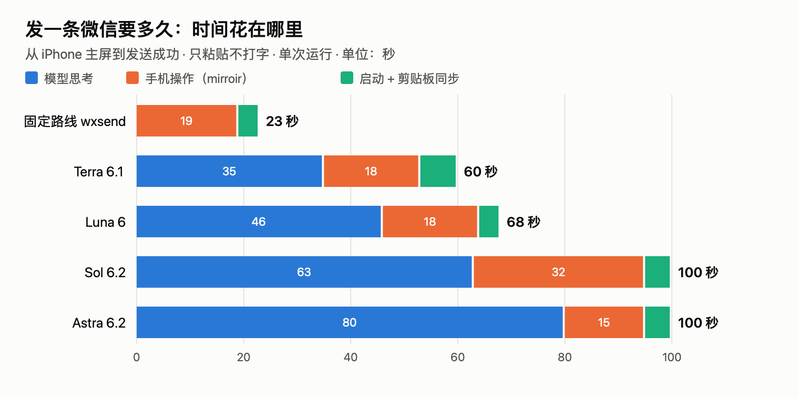

# 测试结果（2026-11-21，第一版）

任务：从 iPhone 主屏出发 → 打开微信 → 进入 File Transfer（文件传输助手）→ 发一条指定消息 → 读屏确认。
环境：mirroir-mcp 0.50.3，Codex CLI，iPhone 镜像窗口 355×782。每种方案只跑了一次。

## 现版 wx 的文件传输助手验收

在同一个已打开的会话里，逐条截图核对了英文、中文、两行文字和结果图。最终新增三个文字气泡和一个图片气泡，顺序正确。第一条带 `--to "File Transfer"`。日志中的输入框 OCR 最终分别读到 `Route check A`、`中文连发核对`、`Line one | Line two`。

本次打开列表中可见的会话用时 7.7 秒。英文、中文成功提交的脚本调用分别用时 9.8 秒和 9.9 秒，图片 10.3 秒。两行草稿经截图核对后重新点入输入框并按回车完成。上述计时不含失败尝试、人工复核和重试。早期记录中约 6 秒一条是已打开对话的连发参考值。

本次遇到了系统通用剪贴板正在同步、光标被回放器识别为遮挡，以及回车时输入框失焦。当前脚本在发送前置顶镜像窗口，粘贴前聚焦输入框，核对草稿后按一次普通回车，图片等待预览后再点发送。遇到 iOS「允许粘贴」弹窗时先处理弹窗再核对输入框。判断是否发出以新增气泡为准。

## 第一版从主屏出发的对比

| 方案 | 结果 | 总耗时 | 模型思考 | 手机操作 | 启动 + 剪贴板 | 点击 + 按键 | 读屏 | Token（输入 / 输出） |
|---|---|---|---|---|---|---|---|---|
| **固定路线 `wxsend`（无模型）** | 成功（连续 4 次） | **23 秒** | 0 | 19 秒 | 4 秒 | 6 | 8（文字识别） | 0 |
| Terra（gpt-6.1-terra） | 成功 | 60 秒 | 35 秒 | 18 秒 | 7 秒 | 5 | 6 | 53 万 / 0.9k |
| Luna（gpt-6-luna） | 成功 | 68 秒 | 46 秒 | 18 秒 | 4 秒 | 4 | 6 | 49 万 / 1.8k |
| Sol（gpt-6.2-sol） | 成功 | 100 秒 | 63 秒 | 32 秒 | 5 秒 | 8 | 11 | 56 万 / 1.9k |
| Astra（gpt-6.2-astra） | 成功，但多发了一条* | 100 秒 | 80 秒 | 15 秒 | 5 秒 | 4 | 5 | 27 万 / 0.7k |

\* Astra 跑之前，输入框里留着它上一次没发出去的草稿（那次它在发送前停下来问用户）。这次它没有清空输入框，就把草稿一起发了出去。Sol 碰到同样的残留文字，会先清空再粘贴。

时间怎么算：总耗时是外层脚本计的时间。「模型思考」和「手机操作」从 Codex 的会话日志里拆出来：一次工具调用从发出到返回算手机操作，其余时间算模型思考。固定路线的时间来自 `mirroir-mcp test` 的分步计时。

## 读法
- **大部分时间花在模型思考上**（四个模型都在 60–80%）。每一步都要走一遍「读屏 → 推理 → 动作」，每一轮还要把越来越长的上下文重新发一遍。
- **Terra 最快、最省**，适合当执行者。**Sol 核对得最仔细**，所以最慢。**Astra 每一轮想得最久**（约 9 秒一轮）。
- 第一版路线固定的操作交给 `wxsend` 回放，模型只决定发什么、发给谁：耗时从 60 秒降到 23 秒，token 从 50 万降到 0。

## 前几轮（手机上打字，仅供参考）
| 方案 | 结果 | 耗时 | 手机操作 |
|---|---|---|---|
| 不给工具，Codex 自己写 Swift 脚本控制 | 成功 | 196 秒 | 26 条 shell 命令 |
| 自己写的按键脚本（逐键输入） | 成功，但输入反复出错 | 465 秒 | 95 次 |
| mirroir 打字（`type_text`），Terra | 成功（选中首字母重新输入，改回小写） | 102 秒 | 25 次调用 |
| mirroir 打字（`type_text`），Luna | 失败：被自动大写卡住 | 134 秒 | 44 次调用 |

前两行的起点是微信里的对话，不是主屏，所以和后面的数字不能直接比较。
